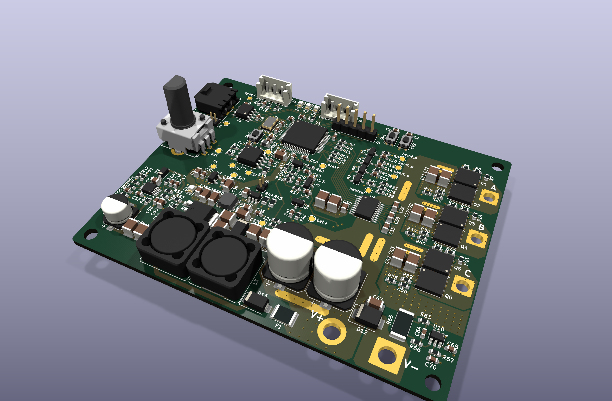
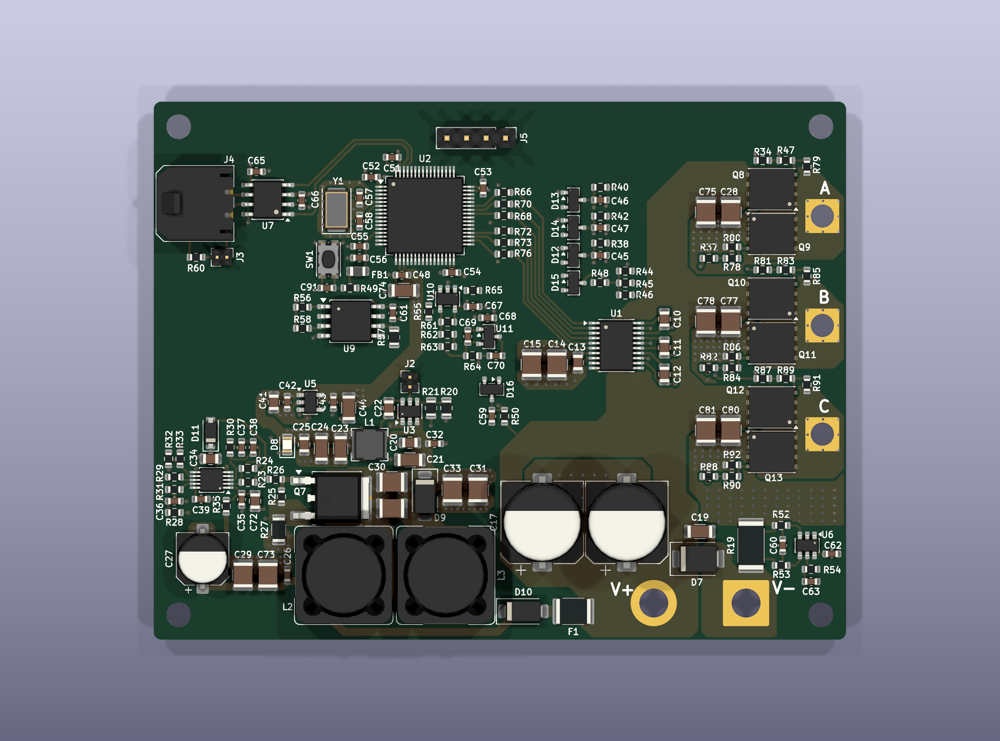
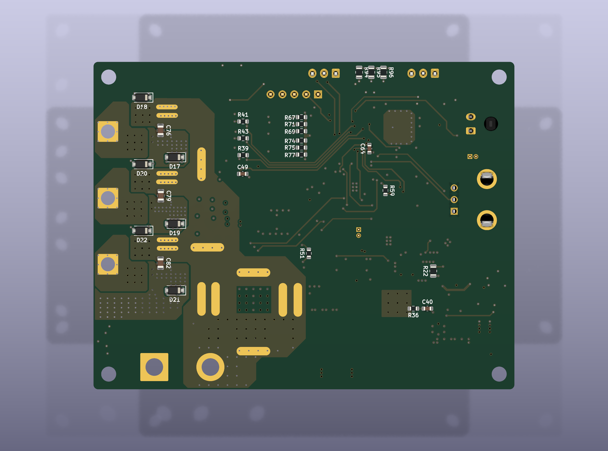

# BLDC_3_6_S — Open-Source 3S–6S Sensorless BLDC Motor Driver



An open-source three-phase BLDC motor driver for 3S–6S lithium battery packs,
designed in KiCad 10. It targets sensorless six-step control using back-EMF
zero-crossing detection, with a single-shunt current sense and a hardware
over-current trip.

> **Status: work in progress.** The schematic is complete and the PCB is being
> routed. The board has **not** been manufactured or tested yet. Do not order
> boards from this revision — see [Known issues](#known-issues--todo).

## Key features

| Block | Implementation |
|---|---|
| Input | 3S–6S Li-ion (≈ 9–25.2 V), SMBJ33CA TVS, polyfuse + Schottky reverse protection for the auxiliary supply |
| Power stage | 6 × TI CSD18540Q5B (60 V, SON 5×6), 2 × 22 µF ceramic per half-bridge, 2 × 330 µF bulk at the input |
| Gate driver | TI DRV8300, 12 V gate drive, separate turn-on / turn-off gate resistors |
| Current sense | 1 mΩ single DC-link shunt + INA181 (bus current, not per-phase), TLV7011 comparator wired to TIM1_BRK for a fast hardware over-current trip, 1.8 V reference (MCP1700) |
| Sensorless feedback | Per-phase back-EMF dividers with RC filter and BAT54S clamps, virtual neutral, DC-bus voltage sense |
| MCU | STM32F103R8T6, 8 MHz crystal, 5-pin SWD header with NRST, 32 Mbit SPI flash (W25Q32JV) |
| Supplies | SEPIC (LM5022) → 12 V gate drive, TPS54302 buck → 5 V, AP2112K → 3.3 V |
| Communication | CAN (TJA1042) on a Molex Micro-Fit 3.0 connector, jumper-selectable 120 Ω termination |
| User I/O | UART debug header (USART3, JST-EH), speed potentiometer, external 0–5 V analog speed input with a 5 V supply pin, 3 status LEDs, 2 push-buttons with RC debounce |
| Monitoring & debug | 12 V gate-drive rail sense, 17 test points (supply rails, BEMF, neutral, current sense, over-current trip, SPI) |
| PCB | 4 layers, 1 oz copper, 90 × 70 mm, solder-wire pads for battery (4 mm²) and motor phases (2.5 mm²) |

**Why a SEPIC?** The gate driver needs a stable 12 V rail, but a 3S pack can sag
below 12 V while a 6S pack sits well above it. A SEPIC can step up or down, so
one supply covers the whole 3S–6S range.

**Design target:** around 30 A phase current. This is a target, not a measured
value; thermal and current capability have not been verified on hardware.

## Images

| Top (3D) | Bottom (3D) |
|---|---|
|  |  |

Top copper and silkscreen: [docs/images/layout_top.png](docs/images/layout_top.png)
Schematic (PDF): [docs/BLDC_3_6_S_schematic.pdf](docs/BLDC_3_6_S_schematic.pdf)

## Repository layout

```
BLDC_3_6_S/            KiCad 10 project (schematic, PCB, design rules)
bldc_lib/symbols/      Project symbol library (DRV8300, TLV7011)
bldc_lib/3dmodels/     Vendor 3D models (not included, see README inside)
docs/                  Renders and schematic PDF
```

All project libraries are referenced relative to the project
(`${KIPRJMOD}/../bldc_lib/...`), so the design opens on any machine with
KiCad 10 and its standard libraries. Only the J4 connector's vendor 3D model has
to be downloaded separately — see [bldc_lib/3dmodels/README.md](bldc_lib/3dmodels/README.md).

## Planned hardware additions

- NTC next to the low-side MOSFETs for thermal protection
- ESD protection on the CAN bus
- RC-PWM (servo-style) speed input on a timer-capable pin, alongside the analog input

## Known issues / TODO

- [x] Move the 5 V buck switch node off the inner layer onto the top layer
- [ ] Finish routing (MCU analog inputs, PWM pull-downs, SPI flash, SWD, remaining GND / 3.3 V connections)
- [ ] Route each high-side gate trace together with its phase (SH) return to shrink the gate loop
- [ ] Connect the SEPIC MOSFET snubber
- [x] Sync capacitor footprints between schematic and PCB (C28, C75, C77, C78, C80, C81 and C23, C24)
- [ ] Clear the remaining ERC / DRC warnings
- [ ] Review copper weight (1 oz vs 2 oz) for continuous high-current operation
- [x] Add UART, speed inputs, status LEDs, push-buttons, 12 V rail sense and test points
- [ ] Add an NTC next to the power stage for thermal protection

## Roadmap

1. Finish the remaining hardware additions, complete layout, clean ERC / DRC
2. First prototype and bring-up
3. Firmware: sensorless six-step commutation with BEMF zero-crossing detection
4. Characterisation: current capability, thermals, efficiency

The board measures DC-link current only, so it is aimed at six-step control.
Field-oriented control would need per-phase current: either single-shunt
phase-current reconstruction (with a faster current-sense amplifier) or a
future hardware revision with per-phase shunts.

## Contributing

Feedback, design reviews and issues are very welcome — especially on the power
stage layout, the sensorless front end and the gate-drive loop. Please open an
issue or a pull request.

## License

This hardware design is licensed under the
**CERN Open Hardware Licence Version 2 – Strongly Reciprocal (CERN-OHL-S-2.0)**.
See [LICENSE](LICENSE) for the full text.

Copyright © 2026 tamergrlli
